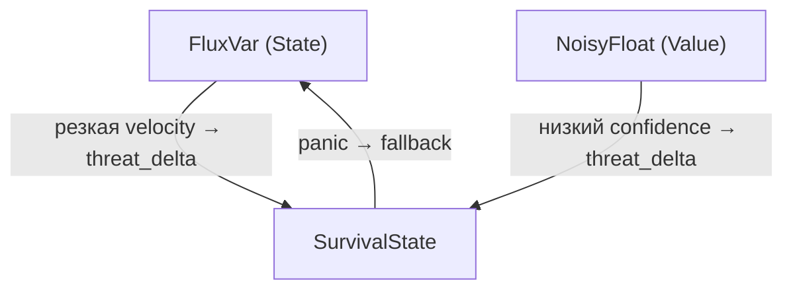

# TRANSFLUX: Архитектура

> Обзор верхнего уровня. Формальная семантика — в [спецификации v0.3](TRANSFLUX_Specification_v0.3.md) (§4), сигнатуры — в [API Reference](TRANSFLUX_API_Reference.md).

## Три ортогональные оси

```
TRANSFLUX = Flow(State) · Uncertainty(Value) · Adaptation(Survival)
```

| Вопрос системы | Ось | Примитив | Модуль |
|---|---|---|---|
| Что у меня есть? | State Model | `FluxVar<T>` | `src/transflux/flux_var.py` |
| Насколько это точно? | Value Model | `NoisyFloat` | `src/transflux/noisy_float.py` |
| Что делать под угрозой? | Survival Model | `SurvivalState` | `src/transflux/survival.py` |

Оси ортогональны: ни одна не является частным случаем другой; примитивы не знают друг о друге напрямую.

## Замкнутая динамическая система



Текстовая версия:

```
State ──velocity──▶ Survival ◀──confidence── Value
                       │
                  panic │ fallback
                       ▼
                     State
```

1. **State → Survival:** резкая `velocity` повышает `threat_level` (`update_from_flow`).
2. **Value → Survival:** низкий `confidence` повышает `threat_level` (`update_from_uncertainty`).
3. **Survival → State:** при panic состояние сбрасывается в `fallback`.

Угроза генерируется не только извне, но и из собственной нестабильности системы — TRANSFLUX самонаблюдающая система.

## Оркестрация: явный цикл

Оси не связываются автоматически. Связь устанавливает **orchestrator** — вызывающий код или `TransfluxSystem` (`src/transflux/system.py`). Это осознанное решение (DR-014): примитивы остаются независимыми и тестируемыми.

Порядок цикла (`TransfluxSystem.tick`):

```
1. State:    flux.update(new_value, dt)
2. Value:    noisy_value из источника
3. Coupling: survival.update_from_flow(flux)
4. Coupling: survival.update_from_uncertainty(noisy_value)
5. Panic:    если panic → flux.update(survival.fallback)
```

## События

Внешний код подключается через синхронные callbacks: `on_trauma` (FluxVar) и `on_panic` (SurvivalState). Callbacks не могут отменить операцию (DR-013); эскалация trauma → survival настраивается явно (Consent-First). Подробности — Event Model, спецификация §4.3.

## Гарантии

Поведение реализации фиксировано инвариантами INV/OP/CP ([Formal Invariants](TRANSFLUX_Formal_Invariants.md)) и проверяется тестами `tests/test_invariants.py`, `tests/test_operations.py`, `tests/test_coupling.py`.
