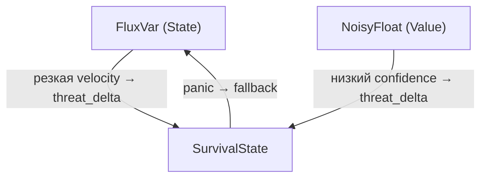

# TRANSFLUX: Формальная спецификация v0.3

> **Статус:** черновик  
> **Автор:** Лариса  
> **Ревизия:** август 2026  
> **Предыдущая версия:** v0.2 (апрель 2026)

---

## 0. Определение парадигмы

**TRANSFLUX** — вычислительная парадигма, основанная на трёх ортогональных осях:

```
TRANSFLUX = Flow(State) · Uncertainty(Value) · Adaptation(Survival)
```

Любая вычислительная система отвечает на три вопроса:

| Вопрос | Ось | Примитив |
|---|---|---|
| Что у меня есть? | State Model | `FluxVar<T>` |
| Насколько это точно? | Value Model | `NoisyFloat` |
| Что делать под угрозой? | Survival Model | `SurvivalState` |

Эти три оси **ортогональны**: ни одна не является частным случаем другой. Все остальные концепции TRANSFLUX выводятся из них как производные.

TRANSFLUX — **эпистемология вычислений**: модель может быть воплощена в Python, Rust, Haskell, LUMEN, протоколах, СУБД и AI-архитектурах. Данная спецификация фиксирует формальное ядро, не привязанное к конкретному языку реализации.

---

## 1. Ось I — State Model: `FluxVar<T>`

### 1.1 Мотивация

В классической парадигме переменная — контейнер: `x = 5` означает «x содержит 5».  
В TRANSFLUX переменная — **русло**: у неё есть направление, история, инерция и комфорт текущего состояния.

```
x = 5        # классика: точка
x ~> 5       # TRANSFLUX: состояние в движении
```

### 1.2 Формальное определение

```python
from dataclasses import dataclass, field
from typing import TypeVar, Generic, List, Optional, Callable
from collections import deque

T = TypeVar('T')

@dataclass
class FluxVar(Generic[T]):
    """Переменная как русло: значение в движении."""

    value: T
    velocity: float = 0.0            # скорость изменения
    acceleration: float = 0.0        # ускорение
    comfort: float = 0.0             # [-1.0, +1.0]: дисфория ↔ эйфория
    history: deque = field(
        default_factory=lambda: deque(maxlen=32)
    )
    trauma_threshold: float = 10.0
    on_trauma: Optional[Callable] = field(default=None, repr=False)

    def update(self, new_value: T, dt: float = 1.0) -> 'FluxVar[T]':
        """Обновить состояние с учётом инерции."""
        if dt <= 0:
            raise ValueError("dt must be positive")

        delta = float(new_value) - float(self.value)
        new_velocity = delta / dt

        if abs(new_velocity) > self.trauma_threshold:
            self._handle_trauma(new_velocity)

        self.acceleration = (new_velocity - self.velocity) / dt
        self.velocity = new_velocity
        self.history.append(self.value)
        self.value = new_value
        self.comfort = max(-1.0, min(1.0, self.comfort))
        return self

    def _handle_trauma(self, velocity: float):
        """
        Резкий скачок — сигнал, не фатал.

        Реализация определяется через callback on_trauma.
        Стратегии реакции на травму (не исчерпывающий список):
        - предупреждение (логирование);
        - смягчение (ограничение скорости, адаптивный шаг);
        - эскалация (передача сигнала в SurvivalState).
        """
        if self.on_trauma:
            self.on_trauma(self, velocity)

    def trajectory(self) -> List[T]:
        """Полная траектория: история + текущее значение."""
        return list(self.history) + [self.value]
```

### 1.3 Семантика оператора `~>`

Оператор `~>` (flow-assignment) — синтаксический сахар для `FluxVar.update()`.  
В отличие от `=`, он подразумевает **течение** к новому значению с учётом инерции и истории.

```python
x ~> 100   ≡   x.update(100)
```

В Python-библиотеке течение записывается методом `flow(new_value, dt)` — это то же самое, что `update()`. Оператор `~>` и отдельный DSL / LUMEN отложены (DR-019): сначала концепция проверяется библиотекой.

### 1.4 Производные концепции

- **FlowingTrit** — непрерывный трит. Полюса `-1`, `0`, `+1` задают смысл (отрицание, порог, утверждение), а само состояние — число с плавающей точкой. `-0.5` — обычное значение, не округление к ближайшей метке. Диапазон не проверяется: значение вне `[-1, 1]` остаётся как есть, это ответственность вызывающего кода (DR-017, DR-018). Траекторию между состояниями даёт `FluxVar[FlowingTrit]`: velocity — вектор перехода.
- **Continuous Becoming** — вычисление как поток `FluxVar`: сущность существует, пока получает поток данных. Архитектурный образ, близкий к сильной реактивности и нейроморфной интуиции «память и процессор не разделены»; в императивном коде реализуется через циклы событий, стримы или runtime.
- **classify_jump** — сравнение скачка с соседями. `|velocity| > trauma_threshold` у одного и тишина у соседей даёт `alone`; скачок вместе с соседом даёт `shared`; иначе `calm`. На пороге скачка ещё нет: сравнение строгое, как у травмы. Функция не меняет ни значение, ни confidence (DR-022). Вызывающий код сам решает, расширять ли uncertainty одиночного датчика перед `weighted_mean`.

### 1.5 Заметка о терминологии

В текстах манифеста используется образ **momentum (инерция)** для описания сопротивления резкому скачку. В формальной модели та же физика выражена через поля `velocity` и `acceleration`. Отдельное поле `momentum` не вводится, пока не требуется модель второго порядка с явной массой.

---

## 2. Ось II — Value Model: `NoisyFloat`

### 2.1 Мотивация

В классической парадигме значение — точка: `5.0`.  
В TRANSFLUX значение — **распределение**: центр, неуверенность и степень доверия.

Шум — не ошибка. Шум — сигнал о природе знания.

### 2.2 Формальное определение

```python
from dataclasses import dataclass
import math

@dataclass
class NoisyFloat:
    """Значение как распределение: центр, неуверенность, доверие."""

    value: float                  # центр распределения (mean)
    uncertainty: float = 0.0     # стандартное отклонение (σ)
    confidence: float = 1.0      # [0.0, 1.0]: степень доверия

    # --- Арифметика с propagation of uncertainty ---
    # Формулы основаны на линейном приближении (first-order Taylor).
    # Confidence propagation: min (слабое звено). Зафиксировано (DR-016).
    # Мультипликативная и байесовская стратегии отложены.

    def __add__(self, other: 'NoisyFloat') -> 'NoisyFloat':
        """σ_z = √(σ_a² + σ_b²)"""
        return NoisyFloat(
            value=self.value + other.value,
            uncertainty=math.sqrt(self.uncertainty**2 + other.uncertainty**2),
            confidence=min(self.confidence, other.confidence)
        )

    def __sub__(self, other: 'NoisyFloat') -> 'NoisyFloat':
        """σ_z = √(σ_a² + σ_b²)  (та же формула, что при сложении)"""
        return NoisyFloat(
            value=self.value - other.value,
            uncertainty=math.sqrt(self.uncertainty**2 + other.uncertainty**2),
            confidence=min(self.confidence, other.confidence)
        )

    def __mul__(self, other: 'NoisyFloat') -> 'NoisyFloat':
        """
        Для z = a·b:
            σ_z = √( b²·σ_a²  +  a²·σ_b² )

        Формула корректна для всех значений, включая нулевые.
        """
        new_value = self.value * other.value
        new_uncertainty = math.sqrt(
            (other.value * self.uncertainty) ** 2 +
            (self.value * other.uncertainty) ** 2
        )
        return NoisyFloat(
            value=new_value,
            uncertainty=new_uncertainty,
            confidence=min(self.confidence, other.confidence)
        )

    def __truediv__(self, other: 'NoisyFloat') -> 'NoisyFloat':
        """
        Для z = a/b:
            σ_z = √( (σ_a/b)²  +  (a·σ_b/b²)² )

        Требует other.value ≠ 0.
        """
        if abs(other.value) < 1e-15:
            raise ZeroDivisionError(
                "Division by NoisyFloat with near-zero value"
            )
        new_value = self.value / other.value
        new_uncertainty = math.sqrt(
            (self.uncertainty / other.value) ** 2 +
            (self.value * other.uncertainty / other.value ** 2) ** 2
        )
        return NoisyFloat(
            value=new_value,
            uncertainty=new_uncertainty,
            confidence=min(self.confidence, other.confidence)
        )

    def is_reliable(self, min_confidence: float = 0.7) -> bool:
        """Достаточно ли мы уверены в этом значении?"""
        return self.confidence >= min_confidence

    def gradient_of_truth(self) -> float:
        """
        Градиент истинности: степень «правдивости» значения
        как функция соотношения сигнал/шум и доверия.

        - При нулевой неуверенности → confidence.
        - При росте шума → экспоненциально убывает.
        """
        if self.uncertainty == 0:
            return self.confidence
        snr = abs(self.value) / (self.uncertainty + 1e-9)
        return self.confidence * (1 - math.exp(-snr))

    def __repr__(self) -> str:
        return (f"NoisyFloat({self.value:.4f} "
                f"± {self.uncertainty:.4f}, "
                f"conf={self.confidence:.0%})")
```

### 2.3 Принцип propagation of uncertainty

Все арифметические операции над `NoisyFloat` **распространяют неуверенность** вперёд по вычислению. Система никогда не теряет информацию о степени доверия к данным.

```python
a = NoisyFloat(5.0, uncertainty=0.3, confidence=0.9)
b = NoisyFloat(2.0, uncertainty=0.1, confidence=0.85)
c = a + b   # → NoisyFloat(7.0000 ± 0.3162, conf=85%)
d = a * b   # → NoisyFloat(10.0000 ± 0.7071, conf=85%)
```

Формулы основаны на линейном приближении propagation of uncertainty (first-order Taylor expansion). Для сильно нелинейных операций или распределений, далёких от нормального, может потребоваться Monte-Carlo propagation или unscented transform — это предмет расширения, не ядра.

Несколько независимых измерений одной величины складываются не через `+` и `/`, а через `weighted_mean`: вес каждого равен `1/σ²`. Тогда

```
value       = Σ(x_i / σ_i²) / Σ(1/σ_i²)
uncertainty = 1 / √(Σ(1/σ_i²))
confidence  = Σ(c_i / σ_i²) / Σ(1/σ_i²)
```

Большое `σ` почти не двигает ни значение, ни confidence. Это сознательно не `min` (DR-020): иначе сбойный датчик запрещал бы итог, даже если его вес близок к нулю. Измерение с `σ = 0` забирает весь вес. Пустой список — ошибка. Формула предполагает независимость; коррелированные датчики она опишет слишком уверенно.

### 2.4 Производные концепции

- **Gradient of Truth** — `NoisyFloat.gradient_of_truth()`: степень истинности как непрерывная величина вместо булева `True/False`. Условие не «включается» резко, а нарастает плавно по мере роста уверенности. Серая зона — нормальное рабочее пространство, а не ошибка.
- **NoisyFlow** — `FluxVar[NoisyFloat]`: переменная-русло, несущая распределение вместо точки. Производный тип на пересечении осей I и II.

### 2.5 Заметка о терминологии

В ранних текстах встречается форма `NoisyFlow(value, dispersion, confidence)`. В спецификации каноническим является `NoisyFloat(value, uncertainty, confidence)`. Поле `dispersion` — синоним `uncertainty` (стандартное отклонение). `NoisyFlow` — не отдельный тип, а алиас для `FluxVar[NoisyFloat]`.

---

## 3. Ось III — Survival Model: `SurvivalState`

### 3.1 Мотивация

В классической парадигме безопасность — защита **целостности данных**.  
В TRANSFLUX безопасность — обеспечение **выживания сущности**.

Приоритет: **выживание > целостность данных > скорость**.

При критической угрозе допускается **уничтожение данных** (data self-destruct): данные намеренно делаются необратимо недоступными — в ущерб целостности, в пользу выживания. В реализации уничтожение данных должно определяться явной политикой (scope, ключи, журналы), а не происходить по умолчанию (см. принцип Consent-First в §3.4).

Panic — не эмоция и не метафора. Это **детерминированный переход состояния** с измеримым триггером и воспроизводимым эффектом.

### 3.2 Формальное определение

```python
from dataclasses import dataclass, field
from typing import Any, Callable, Literal, Optional
import hashlib, os, time

ScopeType = Literal["local", "process", "system"]

@dataclass
class SurvivalState:
    """Модель выживания: непрерывная угроза → дискретное перерождение."""

    threat_level: float = 0.0           # [0.0, 1.0]
    panic_threshold: float = 0.75
    fallback: Any = None                # безопасное состояние для отката
    scope: ScopeType = "local"
    identity_hash: str = field(
        default_factory=lambda: _new_hash()
    )
    decay_rate: float = 0.0             # затухание threat за цикл
    on_panic: Optional[Callable] = field(default=None, repr=False)
    _panic_count: int = field(default=0, repr=False)

    def update(self, threat_delta: float) -> bool:
        """
        Обновить уровень угрозы.
        Применяет decay_rate (затухание) перед добавлением новой угрозы.
        Возвращает True, если был вызван panic.
        """
        self.threat_level = max(0.0, min(1.0,
            self.threat_level - self.decay_rate + threat_delta
        ))
        if self.threat_level >= self.panic_threshold:
            self._panic()
            return True
        return False

    def update_from_uncertainty(self,
                                 noisy: 'NoisyFloat',
                                 sensitivity: float = 0.5):
        """
        Связь с Value Model:
        низкий confidence генерирует угрозу.

        threat_delta = (1 - confidence) × sensitivity
        """
        threat = (1.0 - noisy.confidence) * sensitivity
        return self.update(threat_delta=threat)

    def update_from_flow(self,
                          flux: 'FluxVar',
                          sensitivity: float = 0.1):
        """
        Связь со State Model:
        резкая velocity генерирует угрозу.

        threat_delta = min(1.0, |velocity| × sensitivity)
        """
        threat = min(1.0, abs(flux.velocity) * sensitivity)
        return self.update(threat_delta=threat)

    def _panic(self):
        """
        Детерминированный фазовый переход: перерождение идентичности.

        1. Инкремент счётчика panic.
        2. Генерация нового identity_hash.
        3. Сброс threat_level в 0.
        4. Эффекты зависят от scope:
           - local: только текущий контекст;
           - process: сброс соединений, ротация ключей;
           - system: ротация всей инфраструктуры идентичности.
        """
        self._panic_count += 1
        old_hash = self.identity_hash
        self.identity_hash = _new_hash()
        self.threat_level = 0.0
        if self.on_panic:
            self.on_panic(self, old_hash)
        return self.fallback

    def is_safe(self) -> bool:
        """Уровень угрозы значительно ниже порога."""
        return self.threat_level < self.panic_threshold * 0.5


def _new_hash() -> str:
    """Генерация нового идентификатора (криптографически случайного)."""
    return hashlib.sha256(
        os.urandom(32) + str(time.time_ns()).encode()
    ).hexdigest()
```

### 3.3 Panic как фазовый переход

До порога — **непрерывная адаптация** (плавный рост `threat_level`).  
После порога — **дискретный скачок** (мгновенная смена идентификатора, сброс состояния).

Это гибридная система: `continuous → phase change`, аналог физики фазовых переходов или нейронной активации (spike).

Поле `decay_rate` позволяет моделировать затухание угрозы в стабильных условиях. При `decay_rate = 0` (по умолчанию) threat_level монотонно растёт, и система гарантированно войдёт в panic при любой ненулевой угрозе — параноидный режим. При `decay_rate > 0` система может вернуться в безопасное состояние, если источник угрозы исчезает.

### 3.4 Производные концепции

- **Polyphonic Identity** — `PolyphonicIdentity`: несколько масок одной сущности, у каждой свой хеш. `in_group(group)` отвечает только да или нет и не называет роль. Panic сам книгу масок не трогает.
- **Deadname Erasure** — `erase(old_hash)` заменяет все ссылки на этот хеш одним новым: и слоты, и членство в группах. После возврата старого хеша в книге нет. `rotate_all()` делает это для каждой маски. Вызов — из callback panic или явно, не из самого `SurvivalState` (DR-023).
- **Consent-First** — принцип проектирования API: необратимые и деструктивные операции (уничтожение данных, смена идентичности) не выполняются по умолчанию без явной политики согласия. Противовес тихим побочным эффектам.

---

## 4. Взаимодействие осей

Три оси не изолированы. Они образуют **замкнутую динамическую систему**:



Текстовая версия для сред без Mermaid:

```
State ──velocity──▶ Survival ◀──confidence── Value
                       │
                  panic │ fallback
                       ▼
                     State
```

**Направления связи:**

1. **State → Survival:** резкое изменение velocity в `FluxVar` повышает `threat_level` через `update_from_flow()`.
2. **Value → Survival:** низкий confidence в `NoisyFloat` повышает `threat_level` через `update_from_uncertainty()`.
3. **Survival → State:** при panic состояние сбрасывается в `fallback`.

Это делает TRANSFLUX **самонаблюдающей системой**: угроза генерируется не только извне, но и из собственной нестабильности.

### 4.1 Пример полного взаимодействия

```python
state = FluxVar(value=0.0, trauma_threshold=5.0)
value = NoisyFloat(value=1.0, uncertainty=0.1, confidence=0.95)
survival = SurvivalState(
    panic_threshold=0.75,
    scope="local",
    decay_rate=0.02
)

for t in range(10):
    state.update(new_value=t * 1.5)

    reading = NoisyFloat(
        t * 0.5,
        uncertainty=t * 0.08,
        confidence=max(0.3, 0.95 - t * 0.07)
    )
    value = value + reading

    survival.update_from_flow(state, sensitivity=0.08)
    survival.update_from_uncertainty(value, sensitivity=0.4)

    print(f"t={t}: state={state.value:.1f} | {value} | "
          f"threat={survival.threat_level:.2f} | "
          f"safe={survival.is_safe()}")
```

В этом примере `value` аккумулирует неуверенность (uncertainty растёт с каждым сложением), confidence снижается, и в определённый момент `SurvivalState` входит в panic — перерождая идентичность и сбрасывая threat_level. Это демонстрирует emergent-поведение, возникающее из взаимодействия трёх осей.

### 4.2 Coupling Protocol (протокол связи осей)

Спецификация §4 описывает *какие* связи существуют. Данный раздел определяет *как* они работают на уровне API.

**Модель оркестрации: явный цикл.**

Оси не связываются автоматически. Связь устанавливает **orchestrator** — вызывающий код или объект `TransfluxSystem`. Это решение осознанно (см. DR-014): примитивы остаются независимыми и тестируемыми, coupling — явный и конфигурируемый.

**Порядок обновления в цикле:**

```
1. State:    flux.flow(new_value, dt)
2. Value:    value = compute_value(...)       # NoisyFloat из источника
3. Coupling: survival.update_from_flow(flux)
4. Coupling: survival.update_from_uncertainty(value)
5. Panic:    если panic сработал → flux.flow(survival.fallback, dt)
```

Шаги 3-4 можно выполнять в любом порядке (оба только добавляют threat_delta). Шаг 5 — побочный эффект panic, выполняемый orchestrator-ом.

**Panic → fallback: кто присваивает?**

`SurvivalState._panic()` **возвращает** `self.fallback`, но **не присваивает** его в FluxVar напрямую. Присвоение — ответственность orchestrator-а:

```python
panicked = survival.update_from_uncertainty(value, sensitivity=0.4)
if panicked:
    safe_value = survival.fallback
    if safe_value is not None:
        flux.update(safe_value, dt)
```

Это разделение намеренное: SurvivalState не должен знать о FluxVar (ортогональность). Связь проходит через orchestrator.

**Минимальный TransfluxSystem (эскиз API):**

```python
@dataclass
class TransfluxSystem:
    state: FluxVar
    survival: SurvivalState
    flow_sensitivity: float = 0.1
    uncertainty_sensitivity: float = 0.5
    value: Optional[NoisyFloat] = None   # последнее наблюдение Value
    ticks: int = 0
    backup_value: Any = None             # запасное состояние
    backup_noisy: Optional[NoisyFloat] = None
    degraded: bool = False

    def tick(self, new_value, noisy_value: NoisyFloat, dt: float = 1.0):
        """Один цикл обновления всех осей."""
        if self.degraded and self.backup_armed():
            new_value = self.backup_value
            noisy_value = self.backup_noisy
        self.ticks += 1
        self.state.flow(new_value, dt)
        self.value = noisy_value

        panicked = False
        panicked |= self.survival.update_from_flow(
            self.state, self.flow_sensitivity
        )
        flow_peak = self.survival.peak_threat
        panicked |= self.survival.update_from_uncertainty(
            noisy_value, self.uncertainty_sensitivity
        )
        self.peak_threat = max(flow_peak, self.survival.peak_threat)

        if panicked and self.survival.fallback is not None:
            self.state.flow(self.survival.fallback, dt)
        if panicked and self.backup_armed():
            self.degraded = True

        return panicked
```

`TransfluxSystem` — не обязательный компонент ядра, а рекомендуемый паттерн. Вызывающий код может реализовать оркестрацию самостоятельно.

Запасной режим (DR-021) не включается сам. Он удерживается после panic только если заранее заданы и `backup_value`, и `backup_noisy`. Пока `degraded` истинен, следующие циклы слушают эту пару, а не вход `tick`. `recover()` возвращает систему к входу. Без запасной пары каждый плохой цикл может снова вызвать panic.

### 4.3 Event Model (модель событий)

Примитивы TRANSFLUX взаимодействуют с внешним кодом через **callbacks**.

**Сигнатуры callbacks:**

| Примитив | Callback | Сигнатура | Когда вызывается |
|---|---|---|---|
| `FluxVar` | `on_trauma` | `(flux: FluxVar, velocity: float) → None` | velocity превысила trauma_threshold |
| `SurvivalState` | `on_panic` | `(survival: SurvivalState, old_hash: str) → None` | threat_level достиг panic_threshold |

**Семантика:**

- Callbacks вызываются **синхронно** в процессе update, до возврата из метода.
- Callbacks **не могут отменить** операцию (trauma не блокирует update, panic не отменяется — см. DR-013).
- Callbacks **могут** иметь побочные эффекты: логирование, эскалация trauma в SurvivalState, уведомление внешних систем.
- При отсутствии callback (`None`) событие молча проглатывается.

**Эскалация trauma → survival (типовой паттерн):**

```python
def escalate_trauma(flux, velocity):
    survival.update(threat_delta=abs(velocity) * 0.05)

flux = FluxVar(value=0.0, on_trauma=escalate_trauma)
```

Это превращает trauma из локального сигнала в системное событие, но требует явной настройки — в соответствии с Consent-First.

---

## 5. Производные концепции

| Концепция | Ось-источник | Механизм вывода |
|---|---|---|
| Gradient of Truth | Value (NoisyFloat) | `gradient_of_truth()` = confidence × f(SNR) |
| FlowingTrit | State (FluxVar) | непрерывный float между полюсами `-1`, `0`, `+1`; `-0.5` допустим |
| Continuous Becoming | State (FluxVar) | вычисление = поток, а не вызов |
| NoisyFlow | State × Value | `FluxVar[NoisyFloat]` |
| Polyphonic Identity | Survival | `PolyphonicIdentity`: маски; `in_group` не называет роль |
| Deadname Erasure | Survival | `erase` / `rotate_all` внутри книги, не внутри panic |
| Consent-First | Survival | этика деструктивных операций |

Критерий: если новая концепция не выводится из трёх осей, она либо избыточна, либо это повод пересмотреть базис.

---

## 6. Критерий полноты

Три оси — **минимально полный базис** TRANSFLUX.

Добавление четвёртой оси нарушает ортогональность: любая новая концепция либо выводится из существующих трёх, либо дублирует одну из них.

```
Любая вычислительная система отвечает на три вопроса:
  1. Что у меня есть?       → FluxVar       (State Model)
  2. Насколько это точно?   → NoisyFloat    (Value Model)
  3. Что делать под угрозой? → SurvivalState (Survival Model)
```

Утверждение о полноте — **рабочая гипотеза**. Если в ходе развития обнаружится фундаментальный вопрос, не покрываемый тремя осями, базис должен быть пересмотрен.

---

## 7. Статус и дорожная карта

### 7.1 Текущий статус реализации

| Компонент | Статус | Язык |
|---|---|---|
| `FluxVar<T>`, `flow()`, `classify_jump` | Python-библиотека | Python |
| `NoisyFloat`, `weighted_mean` | Python-библиотека | Python |
| `FlowingTrit` | Python-библиотека | Python |
| `SurvivalState` | Python-библиотека | Python |
| `PolyphonicIdentity` (`erase`, `rotate_all`) | Python-библиотека | Python |
| `TransfluxSystem` (оркестратор, запасной режим) | Python-библиотека | Python |
| Синтетические сценарии | `tests/synthetic/`, графики `docs/figures/synthetic/` | Python |
| Оператор `~>` / DSL / LUMEN | отложен | — |
| Rust, нейроморфное железо, бенчмарки, обёртки ML | отложены | — |

### 7.2 Дорожная карта

**Где мы (октябрь 2026).** Python-библиотека — носитель парадигмы (DR-019). Синтетические сценарии прогоняют три оси вместе. Другие стеки не выбираются.

**Если углублять ту же библиотеку:** `scope` пока только метка; `erase` не видит хеши вне своей книги; `comfort` само не движется; `NoisyFlow` не выделен в тип; `weighted_mean` предполагает независимость измерений. Подробности — в [ROADMAP.md](../ROADMAP.md).

**Отложено:**

DSL / LUMEN, Rust, бенчмарки, нейроморфное железо, обёртки PyTorch / TensorFlow. Если библиотеку сочтут достаточной проверкой, вероятное продолжение — эмбеддинг и микроконтроллеры; конкретный стек к тому моменту придётся выбирать заново.

**Исследовательский бэклог (далеко, не Core):**

Следующие идеи зафиксированы без обязательства войти в ядро и без места в ближайшей работе:

| Идея | К какой оси | Гипотеза |
|---|---|---|
| Grief-Driven GC | State | GC как протокол утраты с историей ссылок |
| Dysphoric Compiler | Value | Диагностика «дискомфорта» в коде вместо сухих ошибок |
| Chosen Family Topology | State | Граф зависимостей как отношения с историей и доверием |
| Body-Budget Scheduler | State | Планировщик с моделью «энергии» и «усталости» |
| Liminal Type Inference | Value | Промежуточные типы как валидные состояния |
| Scar Memory | Survival | Усиленные проверки в местах прошлых сбоев |
| Euphoria-Driven Optimization | Value | Максимизация comfort вместо минимизации loss |
| Algebra of Change | State | Операции над изменениями, композиция трансформаций |
| Time-Native Programming | State | Время и причинность как first-class |

---

## 8. Решения и отложенные вопросы

Журнал решений — в `docs/TRANSFLUX_Open_Questions.md`. Кратко:

### 8.1 Формализм ядра — решено (октябрь 2026)

- **Confidence.** Остаётся `min` (слабое звено). Мультипликативная и байесовская стратегии не входят в библиотеку, пока не понадобятся (DR-016).
- **Constraints.** В `FluxVar` их нет. Допустимость значения контролирует программист. Библиотека не спасает от неверного `value` (DR-017).
- **FlowingTrit.** Состояние — float. Полюса `-1`, `0`, `+1` — ориентиры, не закрытое множество. `-0.5` допустим. Клампа нет (DR-018).

### 8.2 Носитель реализации — решено

- Носитель — Python-библиотека: примитивы, `weighted_mean`, `classify_jump`, `PolyphonicIdentity`, оркестратор с запасным режимом.
- Синтетические сценарии уже гоняют этот код. DSL / LUMEN и Rust отложены. Вероятный горизонт после этого — эмбеддинг и микроконтроллеры (DR-019).

### 8.3 Валидация и дальний бэклог — отложены

Синтетическая проверка есть. Нейроморфный proof-of-concept, бенчмарки, интеграция с фреймворками машинного обучения и исследовательские идеи §7.2 по-прежнему не в работе.

### 8.4 Документация

- ~~Страница «TRANSFLUX и смежные парадигмы»~~ — **реализовано:** см. `docs/TRANSFLUX_Related_Paradigms.md`.
- Унификация API между спецификацией (`FluxVar`) и экспериментальным прототипом (`Flow` в `research/notes/TRANSFLUX.py`). Каноническим является `FluxVar`; `Flow` — ранний эксперимент с альтернативной физической моделью (пружинная динамика с target, см. DR-008).

---

## Приложение A. Терминология

| Термин | Определение | Заметка |
|---|---|---|
| `FluxVar<T>` | Переменная-русло: значение + velocity + acceleration + history + comfort | Каноническое имя в спецификации |
| `NoisyFloat` | Значение как распределение: value + uncertainty + confidence | Каноническое имя |
| `NoisyFlow` | Алиас для `FluxVar[NoisyFloat]` | Пересечение осей I и II |
| `SurvivalState` | Модель выживания: threat_level + panic_threshold + identity + scope | Каноническое имя |
| `momentum` | Образ инерции из манифестных текстов | В коде: velocity + acceleration |
| `dispersion` | Синоним uncertainty в ранних текстах | Каноническое: uncertainty |
| `FlowingTrit` | Непрерывный трит: float, полюса `-1`, `0`, `+1` | `-0.5` допустим; диапазон не клампится |
| `Gradient of Truth` | Степень истинности: f(confidence, SNR) | Производная от NoisyFloat |
| `Polyphonic Identity` | Множество идентификаторов на одну сущность | Производная от SurvivalState |
| `Deadname Erasure` | Атомарная ротация всех ссылок на идентификатор | Производная от SurvivalState |
| `Consent-First` | Принцип: деструктивные операции требуют явного согласия | Производная от SurvivalState |
| `Continuous Becoming` | Вычисление как непрерывный поток, не дискретный вызов | Производная от FluxVar |
| `trauma` | Событие резкого скачка velocity выше trauma_threshold | Часть State Model |
| `panic` | Детерминированный фазовый переход при threat ≥ threshold | Часть Survival Model |
| `decay_rate` | Скорость затухания threat_level в стабильных условиях | Параметр SurvivalState |
| `Panic-First` | Архитектурный принцип: приоритет выживания над целостностью данных | Описывает *приоритеты* системы |
| `Consent-First` | Принцип API: деструктивные операции требуют явной политики | Описывает *этику* API; не противоречит Panic-First — дополняет его |
| `on_trauma` | Callback FluxVar при превышении trauma_threshold | Сигнатура: `(flux, velocity) → None` |
| `on_panic` | Callback SurvivalState при фазовом переходе | Сигнатура: `(survival, old_hash) → None` |
| `TransfluxSystem` | Рекомендуемый паттерн оркестрации трёх осей | Не часть Core, а паттерн использования |

---

*TRANSFLUX — эпистемология вычислений, которую можно воплотить в любом языке.*  
*Код, который течёт, адаптируется и выживает.*
