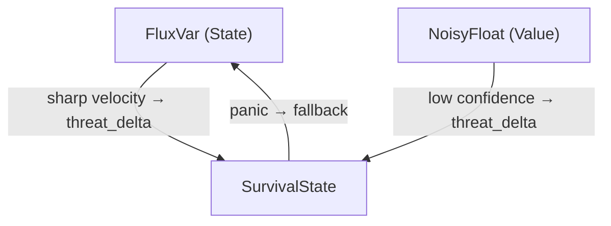

> **Language:** English · [Русский](../ru/TRANSFLUX_Architecture.md)

# TRANSFLUX: Architecture

> A high-level overview. Formal semantics are in the [specification](TRANSFLUX_Specification.md) (§4). Signatures are in the [API reference](TRANSFLUX_API_Reference.md).

## Three orthogonal axes

```
TRANSFLUX = Flow(State) · Uncertainty(Value) · Adaptation(Survival)
```

| The system's question | Axis | Primitive | Module |
|---|---|---|---|
| What do I have? | State Model | `FluxVar<T>`, `FlowingTrit` | `src/transflux/flux_var.py`, `flowing_trit.py` |
| How exact is this? | Value Model | `NoisyFloat` | `src/transflux/noisy_float.py` |
| What to do under threat? | Survival Model | `SurvivalState` | `src/transflux/survival.py` |

The axes are orthogonal: none is a special case of another. The primitives do not know about each other directly.

## A closed dynamical system



Text version:

```
State ──velocity──▶ Survival ◀──confidence── Value
                       │
                  panic │ fallback
                       ▼
                     State
```

1. **State → Survival:** a sharp `velocity` raises `threat_level` (`update_from_flow`).
2. **Value → Survival:** a low `confidence` raises `threat_level` (`update_from_uncertainty`).
3. **Survival → State:** on panic, state is moved to `fallback`.

Threat is generated not only from outside, but also from the system's own instability. TRANSFLUX is a self-observing system.

## Orchestration: an explicit cycle

The axes are not coupled automatically. The coupling is established by an **orchestrator** — calling code, or `TransfluxSystem` (`src/transflux/system.py`). This is a deliberate decision (DR-014): the primitives stay independent and testable.

Cycle order (`TransfluxSystem.tick`):

```
0. Backup:   if degraded and the backup pair is set — substitute the input
1. State:    flux.flow(new_value, dt)
2. Value:    the system stores noisy_value
3. Coupling: survival.update_from_flow(flux)
4. Coupling: survival.update_from_uncertainty(noisy_value)
5. Panic:    if panic → flux.flow(survival.fallback); if the pair is set → degraded
```

## Events

Outside code attaches through synchronous callbacks: `on_trauma` (`FluxVar`) and `on_panic` (`SurvivalState`). Callbacks cannot cancel the operation (DR-013). Escalating trauma into survival is configured explicitly (Consent-First). Details are in the Event Model, specification §4.3.

## Guarantees

Implementation behavior is fixed by the INV/OP/CP invariants ([Formal Invariants](TRANSFLUX_Formal_Invariants.md)) and checked by the tests in `tests/`, including the synthetic scenarios in `tests/synthetic/`.

## What the library contains

Besides the three axes, the package has `FlowingTrit`, `weighted_mean`, `classify_jump`, `PolyphonicIdentity`, and the orchestrator's backup mode (`backup_value`, `backup_noisy`, `degraded`, `recover`). What is not done yet, and what is deferred, is in [ROADMAP.md](../../ROADMAP.md).
