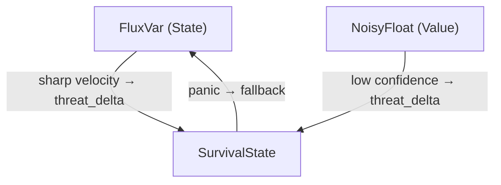

> **Language:** English · [Русский](../ru/TRANSFLUX_Specification.md)

# TRANSFLUX: Formal specification

> **Status:** draft
> **Author:** Лариса
> **Revision:** August 2026 (content lineage: v0.3)

---

## 0. Definition of the paradigm

**TRANSFLUX** is a computational paradigm based on three orthogonal axes:

```
TRANSFLUX = Flow(State) · Uncertainty(Value) · Adaptation(Survival)
```

Any computational system answers three questions:

| Question | Axis | Primitive |
|---|---|---|
| What do I have? | State Model | `FluxVar<T>` |
| How exact is this? | Value Model | `NoisyFloat` |
| What to do under threat? | Survival Model | `SurvivalState` |

These three axes are **orthogonal**: none is a special case of another. Every other TRANSFLUX concept is derived from them.

TRANSFLUX is an **epistemology of computation**: the model can be embodied in Python, Rust, Haskell, LUMEN, protocols, databases, and AI architectures. This specification fixes the formal core, and it is not bound to a particular implementation language.

---

## 1. Axis I — State Model: `FluxVar<T>`

### 1.1 Motivation

In the classical paradigm a variable is a container: `x = 5` means "x contains 5".
In TRANSFLUX a variable is a **channel**: it has a direction, a history, an inertia, and a comfort of the current state.

```
x = 5        # classical: a point
x ~> 5       # TRANSFLUX: a state in motion
```

### 1.2 Formal definition

```python
from dataclasses import dataclass, field
from typing import TypeVar, Generic, List, Optional, Callable
from collections import deque

T = TypeVar('T')

@dataclass
class FluxVar(Generic[T]):
    """A variable as a channel: a value in motion."""

    value: T
    velocity: float = 0.0            # rate of change
    acceleration: float = 0.0        # acceleration
    comfort: float = 0.0             # [-1.0, +1.0]: dysphoria ↔ euphoria
    history: deque = field(
        default_factory=lambda: deque(maxlen=32)
    )
    trauma_threshold: float = 10.0
    on_trauma: Optional[Callable] = field(default=None, repr=False)

    def update(self, new_value: T, dt: float = 1.0) -> 'FluxVar[T]':
        """Update the state, taking inertia into account."""
        if dt <= 0:
            raise ValueError("dt must be positive")

        delta = float(new_value) - float(self.value)
        new_velocity = delta / dt

        if abs(new_velocity) > self.trauma_threshold:
            self._handle_trauma(new_velocity)

        self.acceleration = (new_velocity - self.velocity) / dt
        self.velocity = new_velocity
        self.history.append(self.value)
        self.value = new_value
        self.comfort = max(-1.0, min(1.0, self.comfort))
        return self

    def _handle_trauma(self, velocity: float):
        """
        A sharp jump is a signal, not a fatal error.

        The reaction is defined through the on_trauma callback.
        Strategies for reacting to trauma (not an exhaustive list):
        - a warning (logging);
        - softening (a speed limit, an adaptive step);
        - escalation (passing the signal into SurvivalState).
        """
        if self.on_trauma:
            self.on_trauma(self, velocity)

    def trajectory(self) -> List[T]:
        """The full trajectory: history plus the current value."""
        return list(self.history) + [self.value]
```

### 1.3 Semantics of the `~>` operator

The `~>` operator (flow-assignment) is syntactic sugar for `FluxVar.update()`.
Unlike `=`, it means a **flow** toward the new value, taking inertia and history into account.

```python
x ~> 100   ≡   x.update(100)
```

In the Python library, flow is written with the method `flow(new_value, dt)` — the same thing as `update()`. The `~>` operator and a separate DSL / LUMEN are deferred (DR-019): the concept is checked by the library first.

### 1.4 Derived concepts

- **FlowingTrit** — a continuous trit. The poles `-1`, `0`, and `+1` give the meaning (negation, threshold, affirmation), and the state itself is a floating-point number. `-0.5` is an ordinary value, not a rounding to the nearest label. The range is not checked: a value outside `[-1, 1]` stays as it is. That is the caller's responsibility (DR-017, DR-018). The trajectory between states is given by `FluxVar[FlowingTrit]`: velocity is the transition vector.
- **Continuous Becoming** — computation as a flow of `FluxVar`: an entity exists while it receives a stream of data. An architectural image, close to strong reactivity and to the neuromorphic intuition that "memory and processor are not separate". In imperative code it is realized through event loops, streams, or a runtime.
- **classify_jump** — a comparison of a jump with neighbors. `|velocity| > trauma_threshold` on one sensor and silence among the neighbors gives `alone`; a jump together with a neighbor gives `shared`; otherwise `calm`. At the threshold there is not yet a jump: the comparison is strict, as it is for trauma. The function changes neither the value nor the confidence (DR-022). The caller decides whether to widen the uncertainty of a lone sensor before `weighted_mean`.

### 1.5 A note on terminology

The manifesto texts use the image of **momentum (inertia)** to describe resistance to a sharp jump. In the formal model the same physics is expressed through the fields `velocity` and `acceleration`. A separate `momentum` field is not introduced until a second-order model with an explicit mass is required.

---

## 2. Axis II — Value Model: `NoisyFloat`

### 2.1 Motivation

In the classical paradigm a value is a point: `5.0`.
In TRANSFLUX a value is a **distribution**: a center, an uncertainty, and a degree of trust.

Noise is not an error. Noise is a signal about the nature of knowledge.

### 2.2 Formal definition

```python
from dataclasses import dataclass
import math

@dataclass
class NoisyFloat:
    """A value as a distribution: a center, an uncertainty, a trust."""

    value: float                  # center of the distribution (mean)
    uncertainty: float = 0.0     # standard deviation (σ)
    confidence: float = 1.0      # [0.0, 1.0]: degree of trust

    # --- Arithmetic with propagation of uncertainty ---
    # The formulas are based on a linear approximation (first-order Taylor).
    # Confidence propagation: min (weakest link). Fixed (DR-016).
    # Multiplicative and Bayesian strategies are deferred.

    def __add__(self, other: 'NoisyFloat') -> 'NoisyFloat':
        """σ_z = √(σ_a² + σ_b²)"""
        return NoisyFloat(
            value=self.value + other.value,
            uncertainty=math.sqrt(self.uncertainty**2 + other.uncertainty**2),
            confidence=min(self.confidence, other.confidence)
        )

    def __sub__(self, other: 'NoisyFloat') -> 'NoisyFloat':
        """σ_z = √(σ_a² + σ_b²)  (the same formula as for addition)"""
        return NoisyFloat(
            value=self.value - other.value,
            uncertainty=math.sqrt(self.uncertainty**2 + other.uncertainty**2),
            confidence=min(self.confidence, other.confidence)
        )

    def __mul__(self, other: 'NoisyFloat') -> 'NoisyFloat':
        """
        For z = a·b:
            σ_z = √( b²·σ_a²  +  a²·σ_b² )

        The formula is correct for every value, including zeros.
        """
        new_value = self.value * other.value
        new_uncertainty = math.sqrt(
            (other.value * self.uncertainty) ** 2 +
            (self.value * other.uncertainty) ** 2
        )
        return NoisyFloat(
            value=new_value,
            uncertainty=new_uncertainty,
            confidence=min(self.confidence, other.confidence)
        )

    def __truediv__(self, other: 'NoisyFloat') -> 'NoisyFloat':
        """
        For z = a/b:
            σ_z = √( (σ_a/b)²  +  (a·σ_b/b²)² )

        Requires other.value ≠ 0.
        """
        if abs(other.value) < 1e-15:
            raise ZeroDivisionError(
                "Division by NoisyFloat with near-zero value"
            )
        new_value = self.value / other.value
        new_uncertainty = math.sqrt(
            (self.uncertainty / other.value) ** 2 +
            (self.value * other.uncertainty / other.value ** 2) ** 2
        )
        return NoisyFloat(
            value=new_value,
            uncertainty=new_uncertainty,
            confidence=min(self.confidence, other.confidence)
        )

    def is_reliable(self, min_confidence: float = 0.7) -> bool:
        """Are we sure enough of this value?"""
        return self.confidence >= min_confidence

    def gradient_of_truth(self) -> float:
        """
        Gradient of truth: the degree of "truthfulness" of a value
        as a function of the signal-to-noise ratio and of trust.

        - At zero uncertainty → confidence.
        - As noise grows → it falls exponentially.
        """
        if self.uncertainty == 0:
            return self.confidence
        snr = abs(self.value) / (self.uncertainty + 1e-9)
        return self.confidence * (1 - math.exp(-snr))

    def __repr__(self) -> str:
        return (f"NoisyFloat({self.value:.4f} "
                f"± {self.uncertainty:.4f}, "
                f"conf={self.confidence:.0%})")
```

### 2.3 The principle of propagation of uncertainty

Every arithmetic operation on `NoisyFloat` **propagates uncertainty** forward through the computation. The system never loses information about how much the data can be trusted.

```python
a = NoisyFloat(5.0, uncertainty=0.3, confidence=0.9)
b = NoisyFloat(2.0, uncertainty=0.1, confidence=0.85)
c = a + b   # → NoisyFloat(7.0000 ± 0.3162, conf=85%)
d = a * b   # → NoisyFloat(10.0000 ± 0.7071, conf=85%)
```

The formulas are based on a linear approximation of the propagation of uncertainty (a first-order Taylor expansion). For strongly nonlinear operations, or for distributions far from normal, Monte Carlo propagation or an unscented transform may be needed. That is a matter of extension, not of the core.

Several independent readings of one quantity are not combined through `+` and `/`. They are combined through `weighted_mean`: each weight is `1/σ²`. Then

```
value       = Σ(x_i / σ_i²) / Σ(1/σ_i²)
uncertainty = 1 / √(Σ(1/σ_i²))
confidence  = Σ(c_i / σ_i²) / Σ(1/σ_i²)
```

A large `σ` barely moves either the value or the confidence. This is deliberately not `min` (DR-020): otherwise a faulty sensor would veto the result even when its weight is close to zero. A reading with `σ = 0` takes all the weight. An empty list is an error. The formula assumes independence; it would describe correlated sensors with too much confidence.

### 2.4 Derived concepts

- **Gradient of Truth** — `NoisyFloat.gradient_of_truth()`: a degree of truth as a continuous quantity instead of a Boolean `True/False`. A condition does not "switch on" sharply. It grows smoothly as confidence grows. The grey zone is a normal place to work, not an error.
- **NoisyFlow** — `FluxVar[NoisyFloat]`: a channel-variable that carries a distribution instead of a point. A derived type at the intersection of axes I and II.

### 2.5 A note on terminology

Early texts use the form `NoisyFlow(value, dispersion, confidence)`. In the specification the canonical form is `NoisyFloat(value, uncertainty, confidence)`. The field `dispersion` is a synonym of `uncertainty` (standard deviation). `NoisyFlow` is not a separate type. It is an alias for `FluxVar[NoisyFloat]`.

---

## 3. Axis III — Survival Model: `SurvivalState`

### 3.1 Motivation

In the classical paradigm, safety is the protection of **data integrity**.
In TRANSFLUX, safety is the provision of **the survival of an entity**.

Priority: **survival > data integrity > speed**.

Under a critical threat, **destruction of data** is allowed (data self-destruct): data is deliberately made irreversibly unavailable — at the expense of integrity, in favor of survival. In an implementation, destruction of data must be defined by an explicit policy (scope, keys, logs), and it must not happen by default (see the Consent-First principle in §3.4).

Panic is not an emotion and not a metaphor. It is a **deterministic state transition** with a measurable trigger and a reproducible effect.

### 3.2 Formal definition

```python
from dataclasses import dataclass, field
from typing import Any, Callable, Literal, Optional
import hashlib, os, time

ScopeType = Literal["local", "process", "system"]

@dataclass
class SurvivalState:
    """A model of survival: continuous threat → a discrete rebirth."""

    threat_level: float = 0.0           # [0.0, 1.0]
    panic_threshold: float = 0.75
    fallback: Any = None                # a safe state to fall back to
    scope: ScopeType = "local"
    identity_hash: str = field(
        default_factory=lambda: _new_hash()
    )
    decay_rate: float = 0.0             # threat decay per cycle
    on_panic: Optional[Callable] = field(default=None, repr=False)
    _panic_count: int = field(default=0, repr=False)

    def update(self, threat_delta: float) -> bool:
        """
        Update the threat level.
        Applies decay_rate (fading) before adding the new threat.
        Returns True if panic was invoked.
        """
        self.threat_level = max(0.0, min(1.0,
            self.threat_level - self.decay_rate + threat_delta
        ))
        if self.threat_level >= self.panic_threshold:
            self._panic()
            return True
        return False

    def update_from_uncertainty(self,
                                 noisy: 'NoisyFloat',
                                 sensitivity: float = 0.5):
        """
        The link with the Value Model:
        a low confidence generates threat.

        threat_delta = (1 - confidence) × sensitivity
        """
        threat = (1.0 - noisy.confidence) * sensitivity
        return self.update(threat_delta=threat)

    def update_from_flow(self,
                          flux: 'FluxVar',
                          sensitivity: float = 0.1):
        """
        The link with the State Model:
        a sharp velocity generates threat.

        threat_delta = min(1.0, |velocity| × sensitivity)
        """
        threat = min(1.0, abs(flux.velocity) * sensitivity)
        return self.update(threat_delta=threat)

    def _panic(self):
        """
        A deterministic phase transition: a rebirth of identity.

        1. Increment the panic counter.
        2. Generate a new identity_hash.
        3. Reset threat_level to 0.
        4. The effects depend on scope:
           - local: only the current context;
           - process: reset connections, rotate keys;
           - system: rotate the whole identity infrastructure.
        """
        self._panic_count += 1
        old_hash = self.identity_hash
        self.identity_hash = _new_hash()
        self.threat_level = 0.0
        if self.on_panic:
            self.on_panic(self, old_hash)
        return self.fallback

    def is_safe(self) -> bool:
        """The threat level is significantly below the threshold."""
        return self.threat_level < self.panic_threshold * 0.5


def _new_hash() -> str:
    """Generate a new identifier (cryptographically random)."""
    return hashlib.sha256(
        os.urandom(32) + str(time.time_ns()).encode()
    ).hexdigest()
```

### 3.3 Panic as a phase transition

Before the threshold — **continuous adaptation** (a smooth growth of `threat_level`).
After the threshold — **a discrete jump** (an instant change of identifier, a reset of state).

This is a hybrid system: `continuous → phase change`, an analogue of the physics of phase transitions or of a neural activation (a spike).

The `decay_rate` field makes it possible to model the fading of threat under stable conditions. At `decay_rate = 0` (the default), threat_level grows monotonically, and the system will enter panic under any non-zero threat — a paranoid mode. At `decay_rate > 0` the system can return to a safe state if the source of the threat disappears.

### 3.4 Derived concepts

- **Polyphonic Identity** — `PolyphonicIdentity`: several masks of one entity, each with its own hash. `in_group(group)` answers only yes or no, and it does not name the role. Panic itself does not touch the book of masks.
- **Deadname Erasure** — `erase(old_hash)` replaces every reference to that hash with one new hash: both the slots and the group membership. After the call returns, the old hash is not in the book. `rotate_all()` does this for every mask. The call comes from a panic callback, or it is made explicitly. It does not come from `SurvivalState` itself (DR-023).
- **Consent-First** — a principle of API design: irreversible and destructive operations (destruction of data, a change of identity) are not performed by default without an explicit consent policy. A counterweight to silent side effects.

---

## 4. Interaction of the axes

The three axes are not isolated. They form a **closed dynamical system**:



A text version for environments without Mermaid:

```
State ──velocity──▶ Survival ◀──confidence── Value
                       │
                  panic │ fallback
                       ▼
                     State
```

**Directions of the coupling:**

1. **State → Survival:** a sharp change of velocity in `FluxVar` raises `threat_level` through `update_from_flow()`.
2. **Value → Survival:** a low confidence in `NoisyFloat` raises `threat_level` through `update_from_uncertainty()`.
3. **Survival → State:** on panic, state is reset to `fallback`.

This makes TRANSFLUX a **self-observing system**: threat is generated not only from outside, but also from the system's own instability.

### 4.1 An example of the full interaction

```python
state = FluxVar(value=0.0, trauma_threshold=5.0)
value = NoisyFloat(value=1.0, uncertainty=0.1, confidence=0.95)
survival = SurvivalState(
    panic_threshold=0.75,
    scope="local",
    decay_rate=0.02
)

for t in range(10):
    state.update(new_value=t * 1.5)

    reading = NoisyFloat(
        t * 0.5,
        uncertainty=t * 0.08,
        confidence=max(0.3, 0.95 - t * 0.07)
    )
    value = value + reading

    survival.update_from_flow(state, sensitivity=0.08)
    survival.update_from_uncertainty(value, sensitivity=0.4)

    print(f"t={t}: state={state.value:.1f} | {value} | "
          f"threat={survival.threat_level:.2f} | "
          f"safe={survival.is_safe()}")
```

In this example `value` accumulates uncertainty (uncertainty grows with every addition), confidence falls, and at a certain moment `SurvivalState` enters panic — rebirthing identity and resetting threat_level. This demonstrates emergent behavior that arises from the interaction of the three axes.

### 4.2 Coupling protocol

Section 4 describes *which* couplings exist. This section defines *how* they work at the API level.

**The orchestration model: an explicit cycle.**

The axes are not coupled automatically. The coupling is established by an **orchestrator** — calling code, or a `TransfluxSystem` object. This decision is deliberate (see DR-014): the primitives stay independent and testable, and the coupling is explicit and configurable.

**Update order in the cycle:**

```
1. State:    flux.flow(new_value, dt)
2. Value:    value = compute_value(...)       # a NoisyFloat from the source
3. Coupling: survival.update_from_flow(flux)
4. Coupling: survival.update_from_uncertainty(value)
5. Panic:    if panic fired → flux.flow(survival.fallback, dt)
```

Steps 3–4 may be performed in either order (both only add threat_delta). Step 5 is a side effect of panic, performed by the orchestrator.

**Panic → fallback: who assigns it?**

`SurvivalState._panic()` **returns** `self.fallback`, and it does **not** assign it into FluxVar directly. The assignment is the orchestrator's responsibility:

```python
panicked = survival.update_from_uncertainty(value, sensitivity=0.4)
if panicked:
    safe_value = survival.fallback
    if safe_value is not None:
        flux.update(safe_value, dt)
```

This split is intentional: SurvivalState must not know about FluxVar (orthogonality). The coupling passes through the orchestrator.

**A minimal TransfluxSystem (an API sketch):**

```python
@dataclass
class TransfluxSystem:
    state: FluxVar
    survival: SurvivalState
    flow_sensitivity: float = 0.1
    uncertainty_sensitivity: float = 0.5
    value: Optional[NoisyFloat] = None   # the latest Value observation
    ticks: int = 0
    backup_value: Any = None             # a reserve state
    backup_noisy: Optional[NoisyFloat] = None
    degraded: bool = False

    def tick(self, new_value, noisy_value: NoisyFloat, dt: float = 1.0):
        """One update cycle of every axis."""
        if self.degraded and self.backup_armed():
            new_value = self.backup_value
            noisy_value = self.backup_noisy
        self.ticks += 1
        self.state.flow(new_value, dt)
        self.value = noisy_value

        panicked = False
        panicked |= self.survival.update_from_flow(
            self.state, self.flow_sensitivity
        )
        flow_peak = self.survival.peak_threat
        panicked |= self.survival.update_from_uncertainty(
            noisy_value, self.uncertainty_sensitivity
        )
        self.peak_threat = max(flow_peak, self.survival.peak_threat)

        if panicked and self.survival.fallback is not None:
            self.state.flow(self.survival.fallback, dt)
        if panicked and self.backup_armed():
            self.degraded = True

        return panicked
```

`TransfluxSystem` is not a required component of the core. It is a recommended pattern. Calling code may implement the orchestration itself.

Backup mode (DR-021) does not turn itself on. It is held after panic only if both `backup_value` and `backup_noisy` were set in advance. While `degraded` is true, later cycles listen to that pair, not to the input of `tick`. `recover()` returns the system to the input. Without a backup pair, every bad cycle can cause panic again.

### 4.3 Event model

TRANSFLUX primitives interact with outside code through **callbacks**.

**Callback signatures:**

| Primitive | Callback | Signature | When it is called |
|---|---|---|---|
| `FluxVar` | `on_trauma` | `(flux: FluxVar, velocity: float) → None` | velocity crossed trauma_threshold |
| `SurvivalState` | `on_panic` | `(survival: SurvivalState, old_hash: str) → None` | threat_level reached panic_threshold |

**Semantics:**

- Callbacks are called **synchronously** during update, before the method returns.
- Callbacks **cannot cancel** the operation (trauma does not block update, panic is not cancelled — see DR-013).
- Callbacks **may** have side effects: logging, escalating trauma into SurvivalState, notifying outside systems.
- When there is no callback (`None`), the event is swallowed in silence.

**Escalating trauma → survival (a typical pattern):**

```python
def escalate_trauma(flux, velocity):
    survival.update(threat_delta=abs(velocity) * 0.05)

flux = FluxVar(value=0.0, on_trauma=escalate_trauma)
```

This turns trauma from a local signal into a system event, and it requires an explicit setup — in keeping with Consent-First.

---

## 5. Derived concepts

| Concept | Source axis | How it is derived |
|---|---|---|
| Gradient of Truth | Value (NoisyFloat) | `gradient_of_truth()` = confidence × f(SNR) |
| FlowingTrit | State (FluxVar) | a continuous float between the poles `-1`, `0`, `+1`; `-0.5` is allowed |
| Continuous Becoming | State (FluxVar) | computation = a flow, not a call |
| NoisyFlow | State × Value | `FluxVar[NoisyFloat]` |
| Polyphonic Identity | Survival | `PolyphonicIdentity`: masks; `in_group` does not name the role |
| Deadname Erasure | Survival | `erase` / `rotate_all` inside the book, not inside panic |
| Consent-First | Survival | the ethics of destructive operations |

The criterion: if a new concept does not follow from the three axes, it is either surplus, or it is a reason to revisit the basis.

---

## 6. Completeness criterion

The three axes are the **minimally complete basis** of TRANSFLUX.

Adding a fourth axis breaks orthogonality: any new concept either follows from the existing three, or it duplicates one of them.

```
Any computational system answers three questions:
  1. What do I have?         → FluxVar       (State Model)
  2. How exact is this?      → NoisyFloat    (Value Model)
  3. What to do under threat? → SurvivalState (Survival Model)
```

The completeness claim is a **working hypothesis**. If, as the work develops, a fundamental question appears that the three axes do not cover, the basis must be revisited.

---

## 7. Status and roadmap

### 7.1 Current implementation status

| Component | Status | Language |
|---|---|---|
| `FluxVar<T>`, `flow()`, `classify_jump` | Python library | Python |
| `NoisyFloat`, `weighted_mean` | Python library | Python |
| `FlowingTrit` | Python library | Python |
| `SurvivalState` | Python library | Python |
| `PolyphonicIdentity` (`erase`, `rotate_all`) | Python library | Python |
| `TransfluxSystem` (orchestrator, backup mode) | Python library | Python |
| Synthetic scenarios | `tests/synthetic/`, charts in `docs/figures/synthetic/` | Python |
| The `~>` operator / DSL / LUMEN | deferred | — |
| Rust, neuromorphic hardware, benchmarks, ML wrappers | deferred | — |

### 7.2 Roadmap

**Where we are (October 2026).** The Python library is the carrier of the paradigm (DR-019). Synthetic scenarios run the three axes together. Other stacks are not being chosen.

**If the same library is deepened:** `scope` is still only a label; `erase` does not see hashes outside its book; `comfort` does not move by itself; `NoisyFlow` is not a separate type; `weighted_mean` assumes the readings are independent. The details are in [ROADMAP.md](../../ROADMAP.md).

**Deferred:**

A DSL / LUMEN, Rust, benchmarks, neuromorphic hardware, wrappers for PyTorch / TensorFlow. If the library is judged a sufficient check, the likely continuation is embedding and microcontrollers; the concrete stack will have to be chosen again at that moment.

**Research backlog (far, not Core):**

The following ideas are recorded without a commitment to enter the core, and without a place in the near work:

| Idea | Axis | Hypothesis |
|---|---|---|
| Grief-Driven GC | State | GC as a protocol of loss, with a history of references |
| Dysphoric Compiler | Value | diagnosing "discomfort" in code instead of dry errors |
| Chosen Family Topology | State | a dependency graph as relationships with history and trust |
| Body-Budget Scheduler | State | a scheduler with a model of "energy" and "fatigue" |
| Liminal Type Inference | Value | intermediate types as valid states |
| Scar Memory | Survival | stronger checks in places where failures already happened |
| Euphoria-Driven Optimization | Value | maximizing comfort instead of minimizing loss |
| Algebra of Change | State | operations on changes, composition of transformations |
| Time-Native Programming | State | time and causality as first-class |

---

## 8. Decisions and deferred questions

The decision journal is in `docs/en/TRANSFLUX_Open_Questions.md`. In brief:

### 8.1 Formalism of the core — decided (October 2026)

- **Confidence.** It stays `min` (weakest link). Multiplicative and Bayesian strategies are not in the library until they are needed (DR-016).
- **Constraints.** `FluxVar` does not have them. Whether a value is allowed is controlled by the programmer. The library does not save you from a wrong `value` (DR-017).
- **FlowingTrit.** The state is a float. The poles `-1`, `0`, `+1` are landmarks, not a closed set. `-0.5` is allowed. There is no clamp (DR-018).

### 8.2 The carrier of the implementation — decided

- The carrier is the Python library: the primitives, `weighted_mean`, `classify_jump`, `PolyphonicIdentity`, and an orchestrator with a backup mode.
- Synthetic scenarios already exercise this code. A DSL / LUMEN and Rust are deferred. The likely horizon after this is embedding and microcontrollers (DR-019).

### 8.3 Validation and the far backlog — deferred

The synthetic check exists. A neuromorphic proof of concept, benchmarks, integration with machine-learning frameworks, and the research ideas of §7.2 are still not in the work.

### 8.4 Documentation

- ~~The page "TRANSFLUX and related paradigms"~~ — **done:** see `docs/en/TRANSFLUX_Related_Paradigms.md`.
- Unification of the API between the specification (`FluxVar`) and the experimental prototype (`Flow` in `research/notes/TRANSFLUX.py`). The canonical name is `FluxVar`. `Flow` is an early experiment with an alternative physical model (spring dynamics with a target; see DR-008).

---

## Appendix A. Terminology

| Term | Definition | Note |
|---|---|---|
| `FluxVar<T>` | A channel-variable: value + velocity + acceleration + history + comfort | The canonical name in the specification |
| `NoisyFloat` | A value as a distribution: value + uncertainty + confidence | The canonical name |
| `NoisyFlow` | An alias for `FluxVar[NoisyFloat]` | The intersection of axes I and II |
| `SurvivalState` | A model of survival: threat_level + panic_threshold + identity + scope | The canonical name |
| `momentum` | An image of inertia from the manifesto texts | In code: velocity + acceleration |
| `dispersion` | A synonym of uncertainty in early texts | Canonical: uncertainty |
| `FlowingTrit` | A continuous trit: a float, poles `-1`, `0`, `+1` | `-0.5` is allowed; the range is not clamped |
| `Gradient of Truth` | A degree of truth: f(confidence, SNR) | Derived from NoisyFloat |
| `Polyphonic Identity` | A set of identifiers for one entity | Derived from SurvivalState |
| `Deadname Erasure` | An atomic rotation of every reference to an identifier | Derived from SurvivalState |
| `Consent-First` | A principle: destructive operations require explicit consent | Derived from SurvivalState |
| `Continuous Becoming` | Computation as a continuous flow, not a discrete call | Derived from FluxVar |
| `trauma` | The event of a sharp jump of velocity above trauma_threshold | Part of the State Model |
| `panic` | A deterministic phase transition when threat ≥ threshold | Part of the Survival Model |
| `decay_rate` | How fast threat_level fades under stable conditions | A parameter of SurvivalState |
| `Panic-First` | An architectural principle: survival has priority over data integrity | Describes the system's *priorities* |
| `Consent-First` | An API principle: destructive operations require an explicit policy | Describes the *ethics* of the API; it does not contradict Panic-First — it completes it |
| `on_trauma` | The FluxVar callback when trauma_threshold is crossed | Signature: `(flux, velocity) → None` |
| `on_panic` | The SurvivalState callback at the phase transition | Signature: `(survival, old_hash) → None` |
| `TransfluxSystem` | The recommended pattern for orchestrating the three axes | Not part of Core; a pattern of use |

---

*TRANSFLUX is an epistemology of computation that can be embodied in any language.*
*Code that flows, adapts, and survives.*
